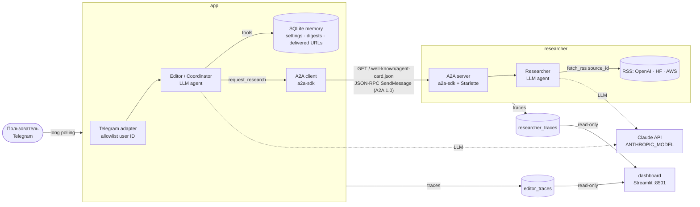

# AI News Digest — Telegram-бот на двух агентах с A2A

Персональный Telegram-бот. По запросу он собирает свежие AI-новости из RSS (OpenAI News, Hugging Face Blog, AWS What's New) и готовит короткий дайджест со ссылками. Интересы и настройки пользователя бот хранит в SQLite.

Внутри работают два самостоятельных LLM-агента на Claude (Anthropic Python SDK):

| Агент | Процесс | Инструменты (allowlist в коде) | Чего у него нет |
|---|---|---|---|
| **Editor / Coordinator** | `app` | `get_user_settings`, `update_user_settings`, `get_digest_history`, `show_last_digest`, `request_research` (A2A-клиент), `submit_digest` | RSS / web-fetch, shell, файлы |
| **Researcher** | `researcher` (A2A-сервер) | `fetch_rss(source_id)`, `submit_selection` | Telegram, настройки пользователя, доступ к БД Editor |

Агенты общаются по **Agent2Agent (A2A) Protocol 1.0** через официальный SDK [`a2a-sdk` 1.2.2](https://github.com/a2aproject/a2a-python). Используется JSON-RPC binding. Agent Card публикуется на `/.well-known/agent-card.json`. Все действия агентов (LLM calls, tool calls, A2A discovery / task / result, работа с памятью, отправка в Telegram, ошибки) пишутся в JSONL-трассы. Read-only dashboard на Streamlit объединяет их по `trace_id`.

> Проект выполнен как финальное задание workshop по Agent Systems.
> Reference: [danil-topchiy/agents-setup](https://github.com/danil-topchiy/agents-setup) (просмотрен commit `b32a94e`).
> Оттуда взяты идеи: роли с разными правами, координатор с делегированием специалисту, memory, канал Telegram и проверки по шагам.
> Код этого репозитория — отдельное минимальное Python-приложение. Внутреннее делегирование OpenClaw (`sessions_spawn`) здесь заменено настоящим A2A.

## Архитектура



Поток запроса «Подготовь дайджест»:
1. Telegram-адаптер проверяет `user_id` по `ALLOWED_TELEGRAM_USER_ID`. Это происходит до обращения к модели.
2. Editor загружает настройки из SQLite и в цикле LLM (≤ 4 итераций, ≤ 8 tool calls) вызывает `request_research`.
3. A2A-клиент получает Agent Card Researcher и отправляет `SendMessage`. В сообщении DataPart с Pydantic-моделью `ResearchRequest`: период, интересы, лимит, `exclude_urls`, `trace_id`.
4. Researcher вызывает `fetch_rss` для каждого источника. Код отбирает записи: окно времени в UTC, без дат — не берутся, canonical URL, дубли и уже доставленные удаляются, AWS фильтруется по интересам, лимиты ≤ 30 записей и ≤ 600 символов excerpt. Затем LLM выбирает релевантные записи через `submit_selection` по `item_id`.
5. Результат возвращается как A2A artifact (`ResearchResult`: request/trace id, окно, `collected_at`, статьи с `relevance_reason`, ошибки источников, флаг `incomplete`). Editor валидирует его.
6. Editor пишет саммари и вызывает `submit_digest`. Код принимает только URL, которые есть в результате Researcher. Без вызова `request_research` дайджест не принимается.
7. Адаптер отправляет дайджест частями. URL помечаются доставленными только после успешной отправки своей части.

### Где граница прав реализована в коде
- `agents/runtime.py`: у каждой роли свой `ToolRegistry`. Модели передаются только инструменты её роли. `dispatch()` повторно проверяет allowlist и возвращает `ToolPermissionError`. Отказ виден в трассе со статусом `denied`.
- `fetch_rss` принимает только `source_id` из `config/sources.toml`. Произвольные URL не принимаются.
- Researcher запускается отдельным контейнером без volume памяти Editor. Ему передаётся только `exclude_urls`.
- Тексты пользователя и RSS передаются модели как данные. Права они расширить не могут: tools фиксированы в коде.

## Версии (проверены 2026-10-11)

| Компонент | Версия |
|---|---|
| Python (Docker) | 3.13-slim |
| a2a-sdk | 1.2.2 — **A2A Protocol 1.0**, JSON-RPC binding (`PROTOCOL_VERSION_CURRENT = "1.0"`) |
| anthropic | 1.13.0 (модель по умолчанию `claude-opus-5-5`, задаётся `ANTHROPIC_MODEL`) |
| python-telegram-bot | 22.8 |
| feedparser / httpx / pydantic / uvicorn | 6.0.14 / 0.28.1 / 2.14.0 / 0.54.0 |
| streamlit | 1.65.0 |

Прямые зависимости перечислены в `requirements.txt`, полный lock — в `requirements.lock`.

## RSS-источники

Список хранится в `config/sources.toml`. Доступность проверена 2026-10-11:

| source_id | URL | Статус |
|---|---|---|
| `openai_news` | https://openai.com/news/rss.xml | RSS 2.0, ~1300 записей, короткие описания |
| `huggingface_blog` | https://huggingface.co/blog/feed.xml | RSS 2.0, **описания пустые**. Саммари строится по заголовку, в дайджесте это помечено |
| `aws_whats_new` | https://aws.amazon.com/about-aws/whats-new/recent/feed/ | RSS 2.0, 100 записей, в основном не про AI. Включён `interest_filter = true` |

Чтобы добавить или отключить источник, отредактируйте `config/sources.toml` (`enabled`, `max_entries`, `interest_filter`) и перезапустите `researcher`.

---

## 1. Требования и установка

- Docker Engine + Docker Compose v2. Проверено на Docker 24 / Compose 2.23.
- Аккаунт Anthropic с API-ключом. Аккаунт Telegram.
- Для локальных тестов без Docker нужен Python ≥ 3.12.

```bash
git clone <URL вашего репозитория> ai-news-digest && cd ai-news-digest
```

## 2. Создание Telegram-бота

1. В Telegram откройте [@BotFather](https://t.me/BotFather) и выполните `/newbot`.
2. Задайте имя и username, который заканчивается на `bot`.
3. BotFather пришлёт токен вида `123456789:AA…`. Это `TELEGRAM_BOT_TOKEN`. Никому его не отправляйте.

## 3. Заполнение секретов (приватно)

```bash
cp .env.example .env
chmod 600 .env
nano .env        # или любой редактор
```

Заполните поля:
- `ANTHROPIC_API_KEY` — ключ из https://console.anthropic.com/ (Settings → API keys). Авторизация Claude Code CLI не является ключом приложения.
- `ANTHROPIC_MODEL` — по умолчанию `claude-opus-5-5`. Подойдут и `claude-sonnet-5-5` или `claude-haiku-5-5` (дешевле и быстрее).
- `TELEGRAM_BOT_TOKEN` — токен от BotFather.
- `ALLOWED_TELEGRAM_USER_ID` — ваш числовой ID (см. следующий раздел).

`.env` указан в `.gitignore` и `.dockerignore`. Секреты не попадают в трассы: ключи, bot token и `Authorization` маскируются, отклонённые user ID не логируются.

## 4. Как узнать свой Telegram user ID

Самый простой способ — написать боту [@userinfobot](https://t.me/userinfobot). Он ответит числом `Id: 123456789`.

Без сторонних ботов: напишите своему боту любое сообщение и выполните

```bash
set -a; . ./.env; set +a
curl -s "https://api.telegram.org/bot${TELEGRAM_BOT_TOKEN}/getUpdates" | python3 -m json.tool | grep -A2 '"from"'
```

Нужно поле `from.id`. Это делается до первого запуска `app`, пока бот не забирает обновления сам.

Без `ALLOWED_TELEGRAM_USER_ID` приложение не стартует и выводит ошибку:
`Configuration error: ALLOWED_TELEGRAM_USER_ID is not set. The bot refuses to start without an allowlist…`

## 5. Сборка и запуск одной командой

```bash
docker compose up -d --build
```

Поднимутся три сервиса:
- `researcher` — A2A-сервер на `researcher:9100`, доступен только внутри сети Compose;
- `app` — Telegram long polling и Editor;
- `dashboard` — http://127.0.0.1:8501, опубликован только на localhost.

## 6. Проверка состояния и dashboard

```bash
docker compose ps                                        # все три сервиса должны быть (healthy)
docker compose exec app python -m ai_news_digest.cli smoke   # LIVE: модель, Telegram getMe, Agent Card
docker compose logs -f app researcher
```

`smoke` проверяет три вещи: `models.retrieve` и короткий `messages.create` для `ANTHROPIC_MODEL` (выводит usage), `getMe` бота и discovery Agent Card Researcher (`JSONRPC`, A2A `1.0`).

Разовый A2A-запрос к Researcher без Telegram (тратит токены):

```bash
docker compose exec app python -m ai_news_digest.cli research --period 72
```

Dashboard: http://127.0.0.1:8501. В нём доступны:
- список запусков: время, `trace_id`, статус, длительность, агенты, A2A task id, токены;
- timeline выбранного запуска: роль, LLM и tool calls, A2A discovery / send / task / result, memory read/write, отправка в Telegram;
- ошибки.

Текстовая сводка доступна командой `docker compose exec dashboard python -m ai_news_digest.cli runs`.

## 7. Остановка и повторный запуск без потери памяти

```bash
docker compose restart app researcher   # перезапуск процессов
docker compose down                     # остановка; volumes НЕ удаляются
docker compose up -d                    # запуск снова: настройки, история и доставленные URL на месте
```

Память лежит в volume `editor_memory` (`/data/editor/memory.sqlite3`), трассы — в `editor_traces` и `researcher_traces`. Команда `/new` в Telegram очищает только краткосрочный контекст беседы.

### Reset памяти (отдельно, необратимо)

Не входит в обычный restart. Удаляет настройки, историю и доставленные URL:

```bash
docker compose run --rm --no-deps app python -m ai_news_digest.cli reset-memory --yes
```

Полное удаление всех данных, включая трассы: `docker compose down -v`.

## 8. Использование, demo и ограничения

Примеры сообщений боту:
- `Запомни: меня интересуют AI agents, MCP и AWS Bedrock. Пиши по-русски, максимум 3 новости`
- `Подготовь дайджест AI-новостей за последние 72 часа`
- `Какие интересы и настройки ты сохранил?`
- `Покажи последний дайджест`
- `Собери ещё один дайджест, пропусти уже отправленные новости`

Команды: `/settings` (настройки напрямую из SQLite), `/last`, `/new`, `/help`.

Каждая новость в дайджесте содержит заголовок, дату публикации (UTC) и источник, саммари из 2–3 предложений по тексту RSS, строку «💡 Возможное применение для Cloud Architect / DevOps (вывод агента)» и исходную ссылку. Внизу есть пометка, что полные статьи не читались. Если источник недоступен, дайджест помечается как неполный. Если релевантных новостей нет, бот так и отвечает.

**Проверка персистентности с лимитом 2:**
1. Отправьте `Запомни: максимум 2 новости`.
2. Выполните `docker compose restart app researcher`.
3. Отправьте `/new`, затем `Какие интересы и настройки ты сохранил?`. Ответ должен содержать лимит 2 (или используйте `/settings`: в строке «источник» будет указано `SQLite`).

Пошаговый сценарий демонстрации с ожидаемыми результатами — в [DEMO.md](DEMO.md). Соответствие критериям задания — в [HOMEWORK_CHECKLIST.md](HOMEWORK_CHECKLIST.md).

### Тесты (offline)

```bash
make venv && make test          # локально: python3 -m venv .venv && .venv/bin/pip install -r requirements.lock && .venv/bin/python -m pytest
make docker-test                # те же тесты внутри Docker-образа
```

В тестах LLM и Telegram заменены фейками. A2A настоящий: uvicorn-сервер Researcher на localhost и SDK-клиент с discovery и валидацией. RSS берётся из fixtures с фиксированным временем `2026-10-10T12:00Z`. Offline-тесты **не доказывают** работу реальной модели и Telegram — для этого нужен live-сценарий из DEMO.md.

Чтобы посмотреть dashboard без ключей (fake LLM, настоящий A2A):

```bash
make offline-demo
TRACE_FILES=data/offline-demo/traces/editor/events.jsonl,data/offline-demo/traces/researcher/events.jsonl \
  .venv/bin/streamlit run dashboard/app.py
```

### Ограничения MVP
- Один разрешённый пользователь, один bot token, работа только по запросу (без расписания).
- Саммари строятся по тексту RSS-анонса. Полные статьи не загружаются, у Hugging Face описаний нет вообще.
- Researcher не стримит прогресс: A2A-вызов блокирующий, timeout 300 с. Повтор (до 2 попыток) выполняется только при сетевых ошибках до создания задачи. Задача в состоянии `FAILED` или timeout не повторяются, чтобы не дублировать работу LLM.
- Хранилище A2A-задач Researcher in-memory: история задач теряется при его рестарте. Трассы остаются.
- Краткосрочный контекст беседы хранится в памяти процесса и теряется при рестарте. Это сделано намеренно: долговременная память только в SQLite.
- Ссылки проверяются на присутствие в результате Researcher и на формат http(s). HTTP-проверка доступности не выполняется: у Editor нет web-fetch.
- Стоимость: один дайджест — примерно 3 + 3 LLM-вызова (Editor и Researcher). Для экономии используйте `ANTHROPIC_MODEL=claude-sonnet-5-5` / `claude-haiku-5-5` и `ANTHROPIC_EFFORT=low`.
- Для моделей, которые это поддерживают (`claude-opus-5-5`, `claude-sonnet-5-5` и др.), включён server-side refusal fallback (beta `server-side-fallback-2026-07-01`, `fallbacks="default"`). Отключается через `ANTHROPIC_REFUSAL_FALLBACK=false`.

## Структура

```
src/ai_news_digest/
  agents/runtime.py        ToolRegistry, bounded agent loop, tracing of LLM/tool calls
  agents/llm.py            Anthropic backend + scripted fake for tests
  researcher/server.py     A2A server: Agent Card, AgentExecutor, TaskUpdater
  researcher/agent.py      Researcher agent: fetch_rss / submit_selection
  researcher/rss.py        fetch, size/time limits, HTML cleanup, canonical URL, filtering
  editor/agent.py          Editor agent, tools, turn handling, delivery accounting
  editor/researcher_client.py  A2A client: discovery, send, retry, result validation
  editor/memory.py         SQLite memory
  editor/digest.py         Telegram HTML rendering + chunking
  telegram_bot.py          Telegram adapter (app entry point), allowlist gate
  models.py                Pydantic contracts (ResearchRequest / ResearchResult …)
  tracing.py               JSONL trace events, redaction
  cli.py                   check-config, smoke, research, runs, reset-memory
dashboard/app.py           Streamlit read-only dashboard
config/sources.toml        RSS sources
tests/                     offline tests + RSS fixtures
```
