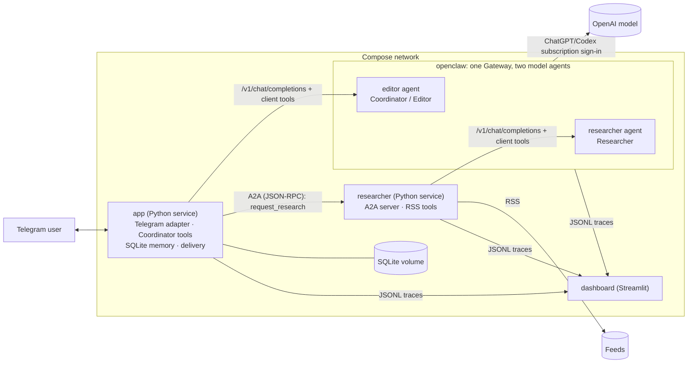

# AI News Digest — a Telegram bot with two OpenClaw agents connected over A2A

A personal Telegram bot that builds AI news digests from RSS feeds. Two **model agents** run in one
[OpenClaw](https://docs.openclaw.ai) Gateway and use your **ChatGPT/Codex subscription** (sign-in, no API keys):

- **Coordinator / Editor** (`editor` agent) — understands the request, reads and saves user settings, asks
  the Researcher for news and writes the digest;
- **Researcher** (`researcher` agent) — decides which RSS sources to fetch and which items are relevant.

The two agents talk over the real **A2A protocol** (official `a2a-sdk`). Python services execute the tools,
keep **persistent memory** in SQLite, deliver messages to **Telegram** and record **traces** for a dashboard.

Verified on 2026-10-11 with OpenClaw 2026.9.9 and model `openai/gpt-5.6-luna` (see [DEMO.md](DEMO.md) and
[HOMEWORK_CHECKLIST.md](HOMEWORK_CHECKLIST.md) for the recorded evidence).

## Architecture



**Model agents vs service roles.** There are exactly two model agents, both inside OpenClaw. The
`app` and `researcher` Python services appear in traces too, but they are **service roles**, not
additional agents: they never call a model. They execute the tool calls chosen by their agent and
return the results to the same OpenClaw session.

One digest request, end to end:

1. `app` receives the Telegram message, checks the owner allowlist, reads settings from SQLite and
   calls the `editor` agent through the Gateway with the Coordinator's client tools.
2. OpenClaw loads the agent's workspace instructions (`AGENTS.md`, `SOUL.md`, `IDENTITY.md`), calls the
   model and returns the chosen tool call. `app` executes it and sends the result back.
3. `request_research` makes `app` send a real A2A task (`ResearchRequest`) to the Researcher service.
4. The Researcher service runs its own loop with the `researcher` agent (a new session per A2A task):
   the model calls `fetch_rss` for the sources and then `submit_selection`. The service executes these
   tools and returns a structured `ResearchResult` as the A2A artifact.
5. The Coordinator calls `submit_digest`; `app` verifies every link against this request's
   `ResearchResult`, renders Telegram HTML, delivers it, records delivered URLs and closes the tool loop.

### Guarantees enforced in code
- **No digest without research.** Every request must end with a confirmed action (`submit_digest`,
  `reply` or `show_last_digest`). Free model text is never delivered: the Gateway is called with
  `tool_choice: "required"`, and an answer without a tool call fails the turn. For digest requests
  (`/digest` or an unambiguous request for a new digest) the first call is pinned to `request_research`
  and `reply` is rejected; `reply` can never contain links.
- **Links only from the current `ResearchResult`.** Foreign trace ids, foreign research and unknown
  argument fields are rejected (`extra="forbid"`); the turn context is created by `app`, not by the model.
- **Least privilege.** OpenClaw tool policy: `tools.profile: "minimal"`, `toolSearch: false`,
  `codeMode: false`, every native tool group denied, cross-agent tools disabled. At runtime both agents
  have 0 native tools after policy and `web_fetch` is refused by the Gateway. The `digest-telemetry`
  plugin also blocks any tool outside each agent's allowlist (`before_tool_call`), and the Python
  services re-check the allowlist when executing. Coordinator tools: `get_user_settings`,
  `update_user_settings`, `get_digest_history`, `show_last_digest`, `request_research`, `submit_digest`,
  `reply`. Researcher tools: `fetch_rss` (configured source ids only), `submit_selection`.
- **Separated roles and sessions.** The Researcher service never receives the Telegram token, has no
  access to SQLite and has no delivery tools. Each A2A task uses its own `researcher` session
  (`research-<request_id>`), so it sees neither the user conversation nor the Coordinator's session.
  Turns of one chat run one at a time; different chats run in parallel in their own sessions.
- **No hidden fallback.** If OpenClaw, the model or the Researcher fails, the user gets a clear error and
  the trace is marked failed. There is no API-key provider at all, so subscription limits cannot silently
  turn into paid API usage.

## Versions (verified 2026-10-11)

| Component | Version |
|---|---|
| OpenClaw | **2026.9.9** (`ghcr.io/openclaw/openclaw:2026.9.9`, Node.js 24.21.0 inside). Gateway OpenAI-compatible `/v1/chat/completions` with client function tools; plugin hooks `llm_input`, `llm_output`, `model_call_started/ended`, `before/after_tool_call`, `agent_end` |
| Model | `openai/gpt-5.6-luna` for both agents (listed as available by the account's live catalog), OpenClaw's own agent runtime (`agentRuntime.id: "openclaw"`) with ChatGPT/Codex sign-in; route `openai-chatgpt-responses` |
| Python (Docker) | 3.13-slim |
| a2a-sdk | 1.2.2 — **A2A Protocol 1.0**, JSON-RPC binding |
| python-telegram-bot | 22.8 |
| feedparser / httpx / pydantic / uvicorn / streamlit | 6.0.14 / 0.28.1 / 2.14.0 / 0.54.0 / 1.65.0 |

The full Python lock is `requirements.lock` (pip freeze of a clean venv built from `requirements.txt`).

**Why OpenClaw's own runtime and not the native Codex app-server?** The Codex app-server brings its own
shell/file tools, which cannot be switched off in a documented way, and it is marked experimental.
OpenClaw's own runtime keeps the documented client-tool loop, the tool policy and the telemetry hooks,
while the model calls still go to the Codex subscription service. OpenClaw would otherwise enable its
"code mode" for this model and hide client tools behind its own `exec`; `codeMode: false` keeps the
application's tools directly visible.

## Workshop mapping

| From the workshop ([agents-setup](https://github.com/danil-topchiy/agents-setup)) | How it is used here |
|---|---|
| OpenClaw Gateway in Docker, token auth, state in a volume | `openclaw` service, isolated volumes `openclaw_state` / `openclaw_workspace`, token auth, Gateway reachable only inside the Compose network |
| Agents with a workspace (`AGENTS.md`, `SOUL.md`, `IDENTITY.md`) | Two agents, `editor` and `researcher`, each with its own workspace in `openclaw/workspace/` |
| Restricting tools with `tools.profile` / `deny` | Stricter: 0 native tools, only the application's client tools per role |
| Delegation via `sessions_spawn` / `sessions_yield` | **Replaced by A2A**: the Coordinator delegates to the Researcher over the A2A protocol |
| Subscription model access | ChatGPT/Codex sign-in (device code), one OAuth profile per agent |
| Telegram channel | python-telegram-bot in `app`, for delivery control and safe message splitting |
| Hermes, nine specialists, Tailscale, GBrain, Paperclip | **Not used.** Hermes is a separate personal assistant with shell, files and memory; this project needs two narrowly scoped roles. The other parts are outside the assignment |

## RSS sources

Sources live in `config/sources.toml` (checked 2026-10-11). `config/` is mounted **read-only** into
`app` and `researcher`, so after editing it run `docker compose restart researcher app`; no rebuild.

| source_id | URL | Note |
|---|---|---|
| `openai_news` | https://openai.com/news/rss.xml | ~1300 entries, short descriptions |
| `huggingface_blog` | https://huggingface.co/blog/feed.xml | empty descriptions: the summary is based on the title, and the digest says so |
| `aws_whats_new` | https://aws.amazon.com/about-aws/whats-new/recent/feed/ | many non-AI entries, `interest_filter = true` |

---

## 1. Prerequisites and clone

- Docker Engine with Docker Compose v2 (tested with Docker 24, Compose 2.23); about 4 GB of disk for the
  OpenClaw image.
- A ChatGPT plan that includes Codex (tested with ChatGPT Plus).
- A Telegram account. `make` is optional (every target is a plain `docker compose` command).

```bash
git clone https://github.com/PLeS207/demo.git ai-news-digest
cd ai-news-digest
```

## 2. Telegram bot and owner ID

1. In Telegram, open **@BotFather**, send `/newbot`, choose a name and copy the token.
2. Get your numeric user ID, for example from **@userinfobot**. The bot answers only this user;
   everyone else gets "⛔ Access denied", and their messages never reach OpenClaw or the model.

## 3. Environment settings (private)

```bash
cp .env.example .env && chmod 600 .env
openssl rand -hex 32          # paste the result into OPENCLAW_GATEWAY_TOKEN
nano .env                     # TELEGRAM_BOT_TOKEN, ALLOWED_TELEGRAM_USER_ID
```

| Variable | Passed to |
|---|---|
| `TELEGRAM_BOT_TOKEN`, `ALLOWED_TELEGRAM_USER_ID` (numeric) | `app` only |
| `OPENCLAW_GATEWAY_TOKEN` (≥ 24 characters) | `openclaw`, `app`, `researcher` |
| `OPENAI_CODEX_MODEL` (default `gpt-5.6-luna`), optional `OPENAI_CODEX_RESEARCHER_MODEL`, `OPENCLAW_THINKING` | `openclaw-init` (written into the OpenClaw config) |
| `DEFAULT_LANGUAGE` (default `en`), `DEFAULT_MAX_ITEMS`, `DEFAULT_PERIOD_HOURS` | `app`; used until the user saves settings |
| `AGENT_MAX_ITERATIONS`, `AGENT_MAX_TOOL_CALLS`, `RSS_MAX_TOTAL_ENTRIES`, `A2A_TIMEOUT_SECONDS`, `A2A_MAX_ATTEMPTS` | `researcher` / `app` limits |

No model API key is needed or accepted: model access comes from the ChatGPT sign-in in step 5.
Secrets never reach traces: tokens, keys and `Authorization` values are masked, rejected user IDs are
not logged, and the dashboard receives no secrets.

## 4. Build and start

```bash
docker compose up -d --build
docker compose ps    # openclaw, researcher, app, dashboard: (healthy); openclaw-init: Exited (0)
```

`openclaw-init` is a one-shot job: it merges the project's settings into the OpenClaw config (keeping the
keys the Gateway manages itself), copies both agent workspaces and fixes volume ownership without
following symlinks. It is safe to re-run on every `up`.

## 5. Sign in to ChatGPT for both agents (once)

Each agent keeps its own OAuth profile. Run the device-code sign-in for **both** agents:

```bash
make login-editor        # = docker compose exec openclaw node openclaw.mjs models auth login \
                         #     --provider openai --method device-code --agent editor
make login-researcher    # the same with --agent researcher
```

For each command: open the shown `auth.openai.com` link, sign in to your ChatGPT account, enter the
one-time code, and when OpenClaw asks about model access choose **Keep current restrictions** (the
config already allows only the configured model). Never paste the code or tokens into chats or files.

- If the sign-in reports that device-code authorization is not enabled, enable device code
  authorization for Codex in your ChatGPT security settings (OpenAI documents device code as an option
  that a security or admin setting must allow) and run the command again.
- Credentials are stored and refreshed by OpenClaw inside the `openclaw_state` volume
  (`agents/<agent>/agent/openclaw-agent.sqlite`). They survive restarts and container recreation; only
  removing the volume deletes them.
- Safe diagnostics (profile type and expiry only, no tokens or e-mail):
  ```bash
  make auth-status
  # editor: [{"type":"oauth","expiresAt":"..."}]
  # researcher: [{"type":"oauth","expiresAt":"..."}]
  ```

### Model and subscription limits
- Change the model with `OPENAI_CODEX_MODEL` (and optionally `OPENAI_CODEX_RESEARCHER_MODEL`), then
  `docker compose up -d`. Use only a model the account lists as available:
  `docker compose exec openclaw node openclaw.mjs models list --provider openai --agent editor --all --refresh`.
- Usage counts against your ChatGPT/Codex allowance. When a limit is reached the bot answers
  "⏳ … the ChatGPT/Codex subscription limit is exhausted or temporarily exceeded … no paid API is used
  instead"; retry later. Token counts reported by the runtime are shown in the dashboard; no dollar
  cost is computed for subscription use.

## 6. Checks

```bash
make smoke          # Gateway + both agent targets, Researcher Agent Card, Telegram getMe (no model calls)
make smoke-turn     # + one real Coordinator turn: the model must call a tool that the app executes
make model-check    # one real Researcher model call that must come back as a submit_selection tool call
make runs           # text summary of traced runs
```

Dashboard: http://127.0.0.1:8501 (published on localhost only; enable "Auto-refresh" in the sidebar).
Each run shows `agents (runtime)` — `app (python)`, `editor (openclaw)`, `researcher (openclaw)`,
`researcher (python)` — the OpenClaw run and session ids, the A2A task id, tool calls, memory, delivery,
errors and token counts. Choosing a run shows its timeline and an "OpenClaw evidence" line per agent
(workspace loaded, native tools after policy, model, route).

### Offline checks (no credentials)

| Kind | Command | Proves | Does not prove |
|---|---|---|---|
| **Unit/fake tests** | `make venv && make test` or `make docker-test` | App logic: tools and validation, routing, the Researcher loop, A2A over HTTP with the SDK, RSS, memory, rendering and delivery, Telegram gate and PTB handlers (fake Bot API), dashboard. OpenClaw is replaced by a **fake Gateway** | OpenClaw itself, the real model, Telegram |
| **Real OpenClaw integration** | `export OPENCLAW_GATEWAY_TOKEN=$(openssl rand -hex 32); make openclaw-check; make openclaw-check-down` | The real Gateway with both agents: workspaces in the system prompts, per-role tools, 0 native tools, refused `web_fetch`, client-tool loops, sessions and `/new`, hooks, one trace across all four roles, errors without fallback. The model is a **scripted fake provider**; separate Compose project `ai-news-digest-offline` with its own volumes and dashboard on http://127.0.0.1:8502 | Model quality, ChatGPT sign-in, Telegram |
| **Live** | [DEMO.md](DEMO.md) | Everything together with your accounts | — |

## 7. Using the bot

Examples (you can write in any language; generated digests and agent replies use the language saved in
your settings, while fixed bot messages are English):

- `Remember: I'm interested in AI agents, MCP and AWS Bedrock. Write in English, at most 4 news items`
- `/digest` or `Prepare an AI news digest for the last 72 hours`
- `What interests and settings have you saved?` or `/settings` (read directly from SQLite)
- `/last` or `Show the last digest` — both use the same full re-send path
- `Build another digest and skip the news you already sent`
- `/new` — a new Coordinator session; settings, history and delivered links stay in SQLite

Every digest item has a title, the UTC publication date, the source, a 2–3 sentence summary based on the
RSS text, a "💡 Possible use … (agent's inference)" line and the link. Long digests are split into
several Telegram messages at self-contained HTML line boundaries — nothing is cut at 4096 characters and
no tag or entity is broken. Re-sending creates no new digest and does not change delivery records.

## 8. Persistence, restart and recreate

| Data | Where | Survives restart / recreate |
|---|---|---|
| Settings, digest history, delivered URLs, conversation ids | `editor_memory` volume, `/data/editor/memory.sqlite3` (SQLite) | yes |
| OpenClaw config, OAuth profiles, agent sessions | `openclaw_state` volume | yes |
| Agent workspaces | `openclaw_workspace` volume (re-copied from `openclaw/workspace/` by `openclaw-init`) | yes |
| Traces | `editor_traces`, `researcher_traces`, `openclaw_traces` volumes | yes |

```bash
docker compose restart openclaw researcher app      # memory, sessions and sign-in survive
docker compose up -d --force-recreate openclaw researcher app
docker compose down                                  # stop; volumes are kept
```

Stop the Gateway with `docker compose stop` (SIGTERM, `stop_grace_period: 60s`): after a hard kill
OpenClaw keeps its state lease and a restart can wait up to 5 minutes.

`/new` starts a new OpenClaw session for the Coordinator (empty short-term context); persistent memory
is unaffected. Deleting the memory is a separate, irreversible step: `make reset-memory`. Never use
`docker compose down -v` on the live project: it deletes memory, sign-in and traces.

## 9. Known limitations

- **Shared operator token.** The Gateway token is a full operator credential (OpenClaw has no
  per-agent token scopes). `app` and the `researcher` service both hold it, so a compromised service
  could call either agent or the Gateway control plane. The Researcher service still never gets the
  Telegram token, the SQLite volume or delivery tools. Strict isolation would need a second Gateway with
  a separate ChatGPT sign-in.
- **One sign-in per agent.** OpenClaw stores a profile per agent; with two agents the CLI cannot write a
  shared profile, and refresh tokens must not be copied by hand. Both profiles are refreshed by OpenClaw.
- **Subscription quota.** A Coordinator turn takes 2–4 Gateway calls (action, tool follow-up, loop
  closure) and a digest adds 2 Researcher calls. With `gpt-5.6-luna` one call is about 3–5k tokens.
- Single user, single bot token, on-demand only (no schedule).
- Summaries come from RSS announcements; full articles are not read. Hugging Face entries have no
  description.
- Natural-text routing to a new digest is based on words like "digest"/"news" (and their Russian
  equivalents) with exclusions such as "last digest", "settings" or "remember". Ambiguous requests are
  decided by the model, still under the tool checks.
- The A2A call is blocking (timeout 300 s, up to 2 attempts on network errors only); the Researcher's A2A
  task store is in-memory.
- OpenClaw loads its bundled plugins (browser, canvas, …) but their tools are denied by policy. The local
  `digest-telemetry` plugin is not signed, so OpenClaw warns that it cannot verify its provenance.
- OpenClaw's own Telegram channel and memory tools are not used: application memory is SQLite.
- The Gateway keeps a few rotating backups of its config (`openclaw.json.bak*`, `openclaw.json.clobbered.*`)
  in `openclaw_state`; older ones may still contain earlier model settings but are not used.

## Repository layout

```
openclaw/
  openclaw.template.json       Gateway, both agents, tool policy, model allowlist, telemetry plugin
  init.mjs                     merges the config, copies workspaces, symlink-safe ownership fix
  workspace/editor/            AGENTS.md, SOUL.md, IDENTITY.md of the Coordinator
  workspace/researcher/        AGENTS.md, SOUL.md, IDENTITY.md of the Researcher
  plugins/digest-telemetry/    hooks -> JSONL traces; blocks tools outside each agent's allowlist
src/ai_news_digest/
  openclaw_client.py           Gateway client (/v1/chat/completions, agent-scoped session keys)
  coordinator/service.py       one turn: OpenClaw <-> tools <-> delivery, loop closure, per-chat lock
  coordinator/tools.py         Coordinator tools: allowlist, schemas, state checks, intent routing
  coordinator/delivery.py      one delivery path: new digest, re-send, text replies
  coordinator/digest.py        Telegram HTML rendering and safe splitting
  coordinator/memory.py        SQLite memory (+ conversations for /new)
  coordinator/researcher_client.py  A2A client
  researcher/                  A2A server, Researcher tools, OpenClaw loop, RSS
  telegram_bot.py              Telegram adapter (entry point of app)
  testing/fakes.py             fake Gateway / scripted model provider (checks only)
  tracing.py                   JSONL traces, masking, joining OpenClaw events
dashboard/app.py               Streamlit, read-only
scripts/openclaw_integration_check.py  real OpenClaw integration check
compose.yaml / compose.offline.yaml
```
