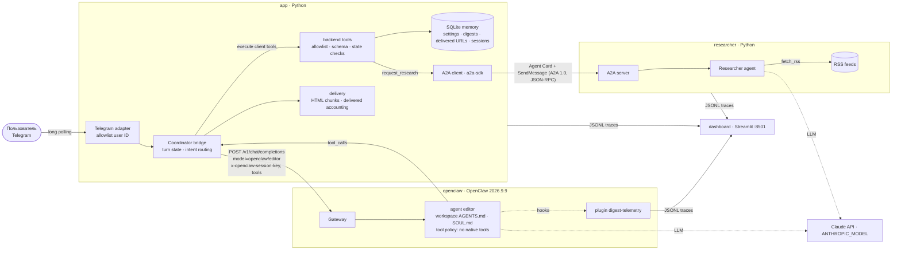

# AI News Digest — Telegram-бот: Coordinator в OpenClaw + Researcher по A2A

Персональный Telegram-бот. По запросу он собирает свежие AI-новости из RSS (OpenAI News, Hugging Face Blog, AWS What's New) и готовит короткий дайджест со ссылками. Интересы и настройки пользователя хранятся в SQLite.

Работают два LLM-агента с разными инструкциями и правами:

| Агент | Runtime | Что делает | Инструменты |
|---|---|---|---|
| **Editor / Coordinator** | **OpenClaw 2026.9.9** (агент `editor`, сервис `openclaw`) | Понимает запрос, выбирает действие, пишет дайджест | Только client tools приложения: `get_user_settings`, `update_user_settings`, `get_digest_history`, `show_last_digest`, `request_research`, `submit_digest`, `reply`. Нативные tools OpenClaw (shell, файлы, web, браузер, messaging, subagents, memory) отключены политикой |
| **Researcher** | Python + Anthropic SDK (сервис `researcher`) | Читает RSS, отбирает релевантное | `fetch_rss(source_id)`, `submit_selection`. Нет Telegram и нет доступа к памяти Coordinator |

Важно понимать границу ответственности. **OpenClaw выполняет Coordinator**: загружает `AGENTS.md` и `SOUL.md` из своего workspace, обращается к модели, выбирает tools и формирует содержание дайджеста. **Telegram-транспорт, исполнение backend tools, прикладная память SQLite, проверка результата и доставка** реализованы Python-компонентом `app`. Native Telegram gateway OpenClaw не используется: так сохраняется контроль результата, деление длинных сообщений и учёт доставки.

Агенты обмениваются данными по **Agent2Agent Protocol 1.0** через официальный SDK [`a2a-sdk` 1.2.2](https://github.com/a2aproject/a2a-python): JSON-RPC binding, Agent Card на `/.well-known/agent-card.json`. Tool `request_research`, который вызывает Coordinator, приводит к настоящему A2A-обмену с Researcher.

> Проект — финальное задание workshop по Agent Systems.
> Reference: [danil-topchiy/agents-setup](https://github.com/danil-topchiy/agents-setup), commit `b32a94e`.
> Сопоставление с workshop — в разделе [«Что взято из workshop»](#что-взято-из-workshop).

## Архитектура



Поток запроса «Подготовь дайджест» (или `/digest`):
1. `app` проверяет Telegram user ID до любого обращения к runtime. Затем создаёт контекст хода: `trace_id`, сохранённые настройки, маршрутизированный intent.
2. `app` вызывает Gateway `POST /v1/chat/completions` с `model: "openclaw/editor"` и ключом сессии беседы. Передаются 7 client tools. Для digest-запроса `tool_choice` привязан к `request_research`.
3. OpenClaw выполняет агент `editor`: system prompt из workspace, вызов модели, выбор tool. Gateway возвращает `tool_calls`.
4. `app` исполняет `request_research`: allowlist, схема аргументов, состояние хода. A2A-клиент находит Researcher по Agent Card и отправляет задачу. Результат `ResearchResult` валидируется. Ответ возвращается в ту же сессию OpenClaw как `role:"tool"`.
5. Агент вызывает `submit_digest`. `app` принимает только URL из `ResearchResult` **этого** хода и только если исследование прошло успешно.
6. `app` доставляет дайджест частями. URL помечаются доставленными после успешной отправки сообщения, в котором находится их ссылка. Затем tool loop закрывается в сессии OpenClaw (`tool_choice: "none"`), закрывающий текст модели пользователю не отправляется.

### Гарантии, реализованные в коде
- **Нет дайджеста без исследования.** Каждый запрос должен завершиться подтверждённым действием (`submit_digest` / `reply` / `show_last_digest`). Свободный текст модели не доставляется: Gateway вызывается с `tool_choice: "required"`, а ответ без tool call даёт ошибку и failed trace. Для digest-запросов (`/digest` или однозначный запрос нового дайджеста) первый вызов привязан к `request_research`, а `reply` в этом потоке отклоняется. `reply` не может содержать ссылки.
- **Ссылки только из текущего `ResearchResult`.** Чужой `trace_id`, чужое исследование, неизвестные поля аргументов отклоняются (`extra="forbid"`). Контекст хода создаёт `app`, а не модель.
- **Права.** OpenClaw: `tools.profile: "minimal"`, `toolSearch: false`, `deny` всех групп нативных tools. В runtime проверено: после применения политики у агента 0 нативных tools, `web_fetch` отклоняется самим Gateway. Plugin `digest-telemetry` дополнительно блокирует через `before_tool_call` любой tool вне allowlist. `app` ещё раз проверяет allowlist при исполнении.
- **Нет скрытого fallback.** Если OpenClaw недоступен (сеть, 401, 5xx), пользователь получает ошибку, trace помечается failed. Старый Python Editor удалён. Если недоступен Researcher, новости не создаются и записи о доставке не появляются.

## Версии (проверены 2026-10-11)

| Компонент | Версия |
|---|---|
| OpenClaw | **2026.9.9** (`ghcr.io/openclaw/openclaw:2026.9.9`, стабильная линия 2026.9; Node.js **24.21.0** внутри образа). Интерфейс: Gateway OpenAI-compatible `/v1/chat/completions` с client function tools; plugin hooks `llm_input`, `llm_output`, `model_call_started/ended`, `before/after_tool_call`, `agent_end` — сверены с `docs/` и `dist/*.d.ts` пакета `openclaw@2026.9.9` |
| Python (Docker) | 3.13-slim |
| a2a-sdk | 1.2.2 — **A2A Protocol 1.0**, JSON-RPC binding |
| anthropic | 1.13.0 (Researcher) |
| python-telegram-bot | 22.8 |
| feedparser / httpx / pydantic / uvicorn / streamlit | 6.0.14 / 0.28.1 / 2.14.0 / 0.54.0 / 1.65.0 |

Модель обоих агентов задаётся `ANTHROPIC_MODEL` (по умолчанию `claude-opus-5-5`). OpenClaw использует её как `anthropic/<ANTHROPIC_MODEL>`. Полный lock Python-зависимостей — `requirements.lock`.

## Что взято из workshop

| Из [agents-setup](https://github.com/danil-topchiy/agents-setup) | Как используется здесь |
|---|---|
| OpenClaw Gateway в Docker (`ghcr.io/openclaw/openclaw`), token auth, state в volume | Сервис `openclaw` с отдельными volumes `openclaw_state` / `openclaw_workspace`, token auth, Gateway только во внутренней сети Compose |
| Агент с workspace (`AGENTS.md`, `SOUL.md`, `IDENTITY.md`) | Агент `editor`, workspace `openclaw/workspace/editor` |
| Ограничение tools через `tools.profile` / `deny` | Ещё строже: нативных tools 0, только client tools приложения |
| Делегирование `sessions_spawn` / `sessions_yield` | **Заменено на A2A**: делегирование Researcher идёт по протоколу A2A через официальный SDK |
| Канал Telegram | Используется python-telegram-bot: нужен контроль доставки и деления сообщений |
| Hermes, девять специалистов, Tailscale, GBrain, Paperclip | **Не используются.** Hermes — отдельный личный ассистент с shell/файлами/памятью; этому MVP нужен один Coordinator с узкими правами и один Researcher. Остальное не требуется заданию |

Собственный Python-код: Telegram-адаптер, backend tools и их проверки, SQLite-память, A2A client/server, Researcher, RSS, рендеринг и доставка, трассы, dashboard.

## RSS-источники

Список хранится в `config/sources.toml`. Каталог `config/` монтируется в `app` и `researcher` **read-only**, поэтому после правки достаточно `docker compose restart researcher app`, пересборка не нужна. Доступность проверена 2026-10-11:

| source_id | URL | Примечание |
|---|---|---|
| `openai_news` | https://openai.com/news/rss.xml | ~1300 записей, короткие описания |
| `huggingface_blog` | https://huggingface.co/blog/feed.xml | описания пустые: саммари по заголовку, это помечается в дайджесте |
| `aws_whats_new` | https://aws.amazon.com/about-aws/whats-new/recent/feed/ | много не-AI новостей, `interest_filter = true` |

---

## 1. Требования и установка

- Docker Engine + Docker Compose v2 (проверено на Docker 24, Compose 2.23). Около 4 ГБ диска под образ OpenClaw.
- Аккаунт Anthropic с API-ключом и аккаунт Telegram.
- Для локальных тестов без Docker нужен Python ≥ 3.12.

```bash
git clone https://github.com/PLeS207/demo.git ai-news-digest && cd ai-news-digest
```

Личная установка OpenClaw (`~/.openclaw`) **не используется и не изменяется**: всё состояние проекта хранится в его Docker volumes.

## 2. Создание Telegram-бота

1. Откройте [@BotFather](https://t.me/BotFather) и выполните `/newbot`.
2. Задайте имя и username, который заканчивается на `bot`.
3. Полученный токен `123456789:AA…` — это `TELEGRAM_BOT_TOKEN`. Никому его не отправляйте.

## 3. Заполнение секретов (приватно)

```bash
cp .env.example .env && chmod 600 .env
openssl rand -hex 32          # скопируйте результат в OPENCLAW_GATEWAY_TOKEN
nano .env
```

| Переменная | Кому передаётся |
|---|---|
| `ANTHROPIC_API_KEY` — https://console.anthropic.com/ → API keys (авторизация Claude Code CLI ключом не является) | `openclaw`, `researcher` |
| `ANTHROPIC_MODEL` (по умолчанию `claude-opus-5-5`; дешевле `claude-sonnet-5-5` / `claude-haiku-5-5`) | `openclaw-init`, `researcher` |
| `OPENCLAW_GATEWAY_TOKEN` (≥ 24 символов) | `openclaw`, `app` |
| `TELEGRAM_BOT_TOKEN` | только `app` |
| `ALLOWED_TELEGRAM_USER_ID` | только `app` |

Секреты не попадают в трассы: ключи, bot token и `Authorization` маскируются, отклонённые user ID не логируются. Dashboard не получает секретов.

## 4. Как узнать свой Telegram user ID

Напишите [@userinfobot](https://t.me/userinfobot) — он ответит `Id: 123456789`. Другой способ: до первого запуска `app` напишите своему боту и выполните

```bash
set -a; . ./.env; set +a
curl -s "https://api.telegram.org/bot${TELEGRAM_BOT_TOKEN}/getUpdates" | python3 -m json.tool | grep -A2 '"from"'
```

Без `ALLOWED_TELEGRAM_USER_ID` сервис `app` не стартует и выводит `Configuration error: ALLOWED_TELEGRAM_USER_ID is not set…`.

## 5. Сборка и запуск одной командой

```bash
docker compose up -d --build
```

Порядок запуска:
1. `openclaw-init` собирает `openclaw.json` из `openclaw/openclaw.template.json` и копирует workspace в volume. Это происходит при каждом запуске: источник истины — репозиторий.
2. `openclaw` — Gateway, порт `18789` только внутри сети Compose.
3. `researcher` — A2A-сервер `researcher:9100`, только внутри сети.
4. `app` — Telegram и Coordinator bridge.
5. `dashboard` — http://127.0.0.1:8501, опубликован только на localhost.

Первый старт OpenClaw занимает до 1–2 минут: выполняется `doctor` и инициализация state.

## 6. Проверка состояния и dashboard

```bash
docker compose ps                                                    # все сервисы (healthy)
docker compose exec app python -m ai_news_digest.cli smoke           # Gateway + агент editor, Agent Card, Telegram getMe
docker compose exec app python -m ai_news_digest.cli smoke --agent-turn   # + один реальный ход Coordinator в OpenClaw (тратит токены)
docker compose exec researcher python -m ai_news_digest.cli model-check  # модель Researcher
docker compose exec dashboard python -m ai_news_digest.cli runs          # текстовая сводка трасс
```

В dashboard (http://127.0.0.1:8501) видно:
- **список запусков**: `trace_id`, статус, длительность, агенты с runtime (`app (python)`, `editor (openclaw)`, `researcher (python)`), число OpenClaw runs, сессия OpenClaw, A2A task id, токены usage от провайдера;
- **timeline** запуска: `openclaw_call` (запрос к Gateway с `openclaw_run_id`), hook-события OpenClaw (`llm_input` с `native_tools_after_policy` и `workspace_instructions_loaded`, `llm_call`, `llm_output` с usage, `tool_call`, `run`), backend `tool_call`, A2A discovery / send / task / result, `rss_fetch`, memory read/write, `telegram_send`, `delivery`, ошибки.

События OpenClaw связываются с трассой приложения по `runId` Gateway: это `id` ответа `/v1/chat/completions`, и его же видят hooks. Если у ответа нет `id` (HTTP 502), связь идёт по ключу сессии и окну хода.

## 7. Остановка и повторный запуск без потери памяти

```bash
docker compose restart openclaw researcher app   # перезапуск
docker compose down                              # остановка; volumes НЕ удаляются
docker compose up -d                             # снова: настройки, история, доставленные URL и сессии на месте
```

- Память `app` лежит в volume `editor_memory` (`/data/editor/memory.sqlite3`). Это прежние имя и путь, поэтому данные, созданные до миграции, сохраняются. Схема расширена совместимо (`CREATE TABLE IF NOT EXISTS conversations`).
- State OpenClaw (сессии) хранится в `openclaw_state`. Трассы — в `editor_traces`, `researcher_traces`, `openclaw_traces`.
- `/new` в Telegram создаёт **новую сессию OpenClaw** (новый `x-openclaw-session-key`). Старая история в неё не передаётся, прикладная память остаётся.
- OpenClaw держит lease на state-каталоге. Корректная остановка (`stop_grace_period: 60s`) освобождает его сразу. После жёсткого `kill` новый запуск ждёт до 5 минут: это поведение OpenClaw.

### Reset памяти (отдельно, необратимо)

Не входит в обычный restart. Удаляет настройки, историю и доставленные URL:

```bash
docker compose run --rm --no-deps app python -m ai_news_digest.cli reset-memory --yes
```

Полное удаление всех данных, включая сессии OpenClaw и трассы: `docker compose down -v`.

## 8. Использование, demo и ограничения

Сообщения боту:
- `Запомни: меня интересуют AI agents, MCP и AWS Bedrock. Пиши по-русски, максимум 3 новости`
- `/digest` или `Подготовь дайджест AI-новостей за последние 72 часа`
- `Какие интересы и настройки ты сохранил?`
- `/last` или `Покажи последний дайджест` — оба способа идут через один путь полной повторной отправки
- `Собери ещё один дайджест, пропусти уже отправленные новости`

Команды: `/digest`, `/settings` (настройки напрямую из SQLite), `/last`, `/new`, `/help`.

Каждая новость в дайджесте содержит заголовок, дату UTC, источник, саммари из 2–3 предложений по тексту RSS, строку «💡 Возможное применение … (вывод агента)» и ссылку. Длинный дайджест делится на сообщения по границам самодостаточных HTML-строк. Обрезки `[:4096]` нет, теги и entities не разрываются. Длинные ссылки показываются сокращённым текстом при полном `href`. Повторная отправка не создаёт новый дайджест и не меняет учёт доставленных URL.

Пошаговый сценарий — [DEMO.md](DEMO.md). Соответствие критериям — [HOMEWORK_CHECKLIST.md](HOMEWORK_CHECKLIST.md).

### Три вида проверок

| Вид | Команда | Что доказывает | Что НЕ доказывает |
|---|---|---|---|
| **Fake-тесты** (pytest) | `make test` или `make docker-test` | Логику app: tools и проверки, маршрутизацию, A2A по HTTP с SDK, RSS, память, рендеринг и доставку, Telegram-гейт и хендлеры PTB (фейковый Bot API), dashboard. OpenClaw заменён **fake Gateway** | Интеграцию с OpenClaw, реальную модель, Telegram |
| **Интеграция с настоящим OpenClaw** | `export OPENCLAW_GATEWAY_TOKEN=$(openssl rand -hex 32); make openclaw-check; make openclaw-check-down` | Настоящий Gateway 2026.9.9: загрузку workspace, effective tools (0 нативных), client tool loop, сессии и `/new`, hooks, общий trace app + OpenClaw + Researcher, отказ `web_fetch`, ошибки без fallback. Модель — **контролируемый fake-провайдер**, отдельный Compose-проект с отдельными volumes | Качество реальной модели и Telegram |
| **Live** | DEMO.md | Всё вместе с вашими ключами | — |

Dashboard без ключей и без OpenClaw (fake Gateway, настоящий A2A): `make venv && make offline-demo`, затем `TRACE_FILES=data/offline-demo/traces/app/events.jsonl,data/offline-demo/traces/researcher/events.jsonl .venv/bin/streamlit run dashboard/app.py`.

### Ограничения MVP
- Один пользователь, один bot token, работа по запросу без расписания.
- Саммари строятся по RSS-анонсам, полные статьи не читаются. У Hugging Face описаний нет.
- Каждый ход Coordinator включает 2–4 вызова Gateway: действие, tool follow-up и закрытие tool loop. Один вызов Gateway может включать несколько вызовов модели — их считают hook-события `llm_call`. Для экономии используйте `claude-sonnet-5-5` / `claude-haiku-5-5` и `OPENCLAW_THINKING=low`.
- Маршрутизация intent для естественного текста основана на словах «дайджест/digest/новости» и исключениях вроде «последний дайджест» или «настройки». Неоднозначные запросы решает модель, но под проверками tools.
- A2A-вызов блокирующий, timeout 300 с. Повтор (до 2 попыток) выполняется только при сетевых ошибках. Хранилище A2A-задач Researcher in-memory.
- OpenClaw загружает свои bundled plugins (browser, canvas и др.), но их tools запрещены политикой. Plugin `digest-telemetry` локальный: OpenClaw предупреждает, что не может проверить его происхождение. Код plugin — в `openclaw/plugins/digest-telemetry`.
- Native Telegram-канал и память OpenClaw (`memory_search`) не используются: память приложения — SQLite.

## Структура

```
openclaw/
  openclaw.template.json       конфиг Gateway, агента editor, tool policy, plugin
  init.mjs                     сборка конфига + копирование workspace (сервис openclaw-init)
  workspace/editor/            AGENTS.md, SOUL.md, IDENTITY.md агента Coordinator
  plugins/digest-telemetry/    hooks → JSONL трассы; блокировка tools вне allowlist
src/ai_news_digest/
  coordinator/openclaw_client.py  клиент Gateway /v1/chat/completions
  coordinator/service.py          ход: OpenClaw ↔ tools ↔ доставка, закрытие tool loop
  coordinator/tools.py            backend tools: allowlist, схемы, проверки состояния, intent
  coordinator/delivery.py         единый путь отправки: новый дайджест, повтор, ответы
  coordinator/digest.py           Telegram HTML + деление без обрезки
  coordinator/memory.py           SQLite (+ conversations для /new)
  coordinator/researcher_client.py  A2A client
  researcher/                     A2A server, Researcher agent, RSS
  telegram_bot.py                 Telegram adapter (точка входа app)
  testing/fakes.py                fake Gateway / fake model provider (только для проверок)
  tracing.py                      JSONL трассы, маскирование, join событий OpenClaw
dashboard/app.py                  Streamlit, read-only
scripts/openclaw_integration_check.py  интеграция с настоящим OpenClaw
compose.yaml / compose.offline.yaml
```
